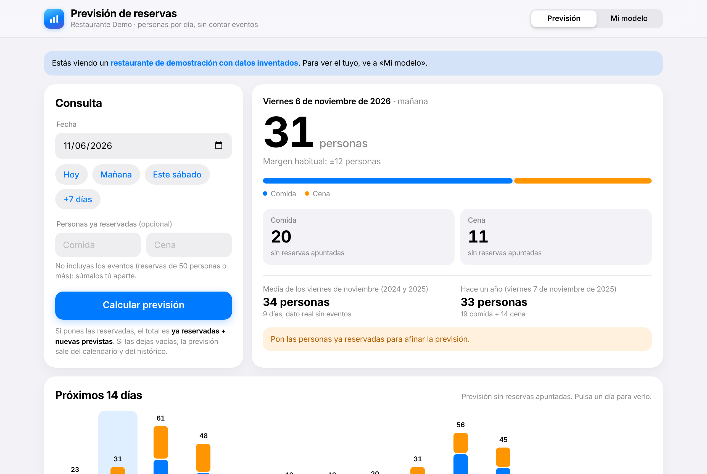
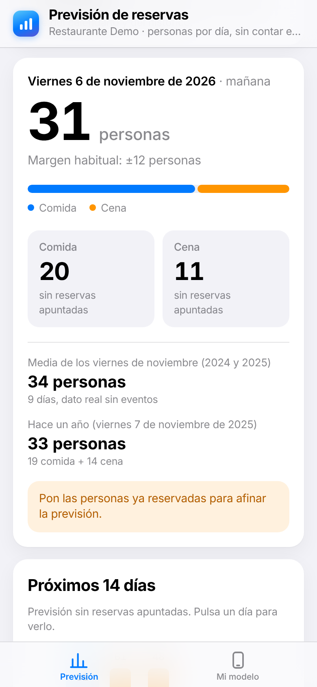
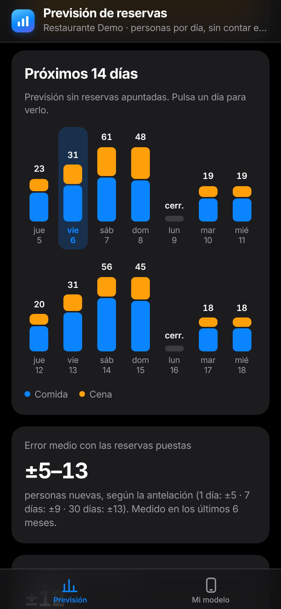

<div align="center">


# Previsión de reservas

**Cuántas personas vendrán a tu restaurante cada día, a comida y a cena.**

Aprende del histórico de reservas de CoverManager con modelos LightGBM y funciona en el móvil como una app.

[**Abrir la demo**](https://valentin140623.github.io/API-Reservas/) ·
[Cómo funciona](#cómo-funciona) ·
[Arquitectura](#arquitectura) ·
[Desarrollo](#desarrollo)




&nbsp;&nbsp;

</div>

## Qué hace

- **Previsión por día y turno.** Comensales esperados a comida y a cena, con su margen de error habitual.
- **Con o sin reservas.** Sin datos, la previsión sale del calendario y del histórico. Con las personas
  ya reservadas, el modelo estima cuántas faltan por llegar según los días de antelación.
- **Contexto del día.** Festivos, puentes, días especiales, comparación con el mismo día de otros años
  y el tiempo previsto (Open-Meteo).
- **Próximos 14 días** de un vistazo.
- **Reentrenamiento automático** cada vez que se importan nuevos informes de CoverManager.
- **Diseño nativo.** Estilo iOS con modo oscuro, barra de pestañas en el móvil y se instala en la
  pantalla de inicio (PWA). La previsión se calcula en el propio dispositivo y funciona sin conexión.

## Dos versiones

| | **Ligera** (GitHub Pages) | **Completa** (servidor) |
|---|---|---|
| Uso | Consultar la previsión en el móvil | Gestión del restaurante |
| Instalación | Ninguna: es un enlace | Docker o Node.js + Python |
| Previsión por día y turno | ✅ | ✅ |
| Importar informes de CoverManager | — | ✅ |
| Reentrenamiento | — | ✅ automático |
| Cuentas de usuario | — | ✅ |
| Dónde están los datos | Solo en el dispositivo (IndexedDB) | Base de datos del servidor |

El equipo comparte el modelo sin servidor de pago: desde *Datos → Compartir con compañeros* se envía
el modelo entrenado (un `.json`) junto con el enlace de la versión ligera. Al abrirlo en el móvil, el
modelo se guarda solo en ese dispositivo.

## Cómo funciona

1. **Importación.** Se leen los dos informes de CoverManager: reservas (`report_reserv_stats_basic.csv`)
   y personas por turno (`report_persons_turn_days.csv`). Volver a importar un periodo sustituye esas
   fechas, sin duplicar.
2. **Resumen diario.** Por cada día y turno: personas que vinieron (reservas sentadas, llegadas o
   confirmadas), reservadas y cerrado. Los grupos de 50 personas o más cuentan como eventos y van aparte.
3. **Entrenamiento.** Cuatro modelos LightGBM: comida y cena, con y sin reservas ya apuntadas. Usan el
   día de la semana, la época del año, festivos y sus vísperas, puentes y vacaciones escolares; los de
   reservas añaden las personas ya apuntadas y los días de antelación.
4. **Validación.** El error se mide entrenando sin los últimos 6 meses y comparando con lo que pasó de
   verdad. Un modelo nuevo solo sustituye al actual si no empeora el error más de un 15 %.
5. **Previsión.** Los árboles se exportan a JSON y se evalúan en el navegador, de modo que la consulta
   es instantánea y no necesita servidor.

## Arquitectura

```
src/motor/               Motor de previsión en TypeScript (evalúa los árboles), con tests
src/componentes/         Interfaz en React
src/modo.ts              Versión ligera (VITE_MODO=navegador) o completa
backend/app/main.py      API FastAPI: cuentas, modelo, importación y reentrenamiento; sirve la web
backend/app/importar.py  Lectura de los informes de CoverManager
backend/app/resumen.py   Resumen diario por turno
backend/app/entrenar.py  Entrenamiento y validación (LightGBM)
backend/app/seguridad.py Contraseñas (scrypt) y cookie de sesión firmada (HMAC)
backend/modelos/demo.json Modelo de demostración, entrenado con datos sintéticos
```

**Tecnología:** React 19 · TypeScript · Vite · Vitest · FastAPI · SQLAlchemy · SQLite / PostgreSQL ·
LightGBM · Docker · GitHub Actions.

## Privacidad

El repositorio no contiene datos reales. El único modelo incluido es `backend/modelos/demo.json`,
generado a partir de reservas sintéticas con `backend/scripts/crear_modelo_demo.py`. Los modelos
propios, los CSV, la base de datos y la clave de sesiones están excluidos en `.gitignore`.

## Desarrollo

Requisitos: [Node.js](https://nodejs.org/) LTS y [Python 3.13](https://www.python.org/downloads/).

```bash
# API (http://localhost:8000/docs)
cd backend
python -m venv .venv
.venv/bin/pip install -r requirements.txt        # Windows: .venv\Scripts\pip
.venv/bin/uvicorn app.main:app --reload

# Web (http://localhost:5173)
npm install
npm run dev
```

En Windows, `iniciar.bat` hace todo lo anterior y abre el navegador.

Al arrancar por primera vez, la web pide crear la cuenta del restaurante, que empieza con el modelo de
demostración. Al importar los primeros informes se entrena un modelo con los datos reales.

**Tests:** `npm test` (motor y equivalencia con el prototipo original) y
`cd backend && .venv/bin/python -m pytest` (importación, sesiones y entrenamiento).

## Despliegue

**Versión ligera.** `.github/workflows/pages.yml` la publica en GitHub Pages con cada push a `main`
(requiere *Settings → Pages → Source: GitHub Actions*).

**Versión completa.** `render.yaml` define un Blueprint de [Render](https://render.com) con el
servidor (`Dockerfile`, una sola imagen para web y API) y una base de datos PostgreSQL.

| Variable | Descripción |
|---|---|
| `DATABASE_URL` | Conexión a PostgreSQL (por defecto, SQLite local) |
| `SECRET_KEY` | Clave de firma de las sesiones |
| `COOKIE_SEGURA=1` | La cookie de sesión solo viaja por HTTPS |
| `PRIMER_EMAIL` | Único email autorizado a crear la primera cuenta |
| `MODELO_INICIAL` | Modelo de partida en `backend/modelos/` (por defecto `demo.json`) |

## Hoja de ruta

- [x] Motor de previsión en React + TypeScript, con tests y CI
- [x] Importación de informes de CoverManager
- [x] Cuentas de usuario por restaurante
- [x] Reentrenamiento automático
- [x] Despliegue con Docker, versión ligera para el móvil y diseño nativo
- [ ] Alta de nuevos restaurantes con su ubicación y calendario de festivos
- [ ] Planes de suscripción e integración directa con CoverManager

---

© 2026 Valentin. Todos los derechos reservados.
